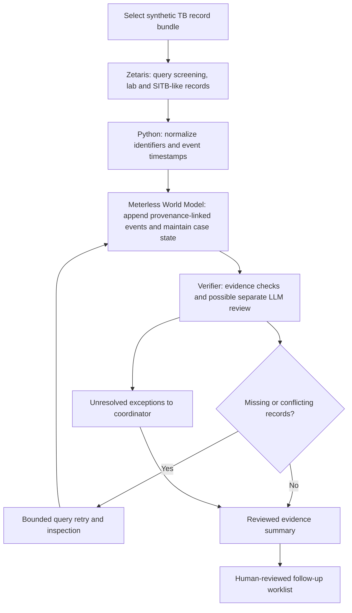

# TB-CareFlow — intended sponsor architecture (not yet implemented)

**Sponsor role correction (19 Oct 2026):** Meterless World Model supplies event-sourced state, identity resolution and provenance. It is **not** automatically an LLM evaluator. Semantic critique, if added, will be a separate agent component with independent validation; do not imply an LLM model is supplied merely by importing a World Model reference.

Proposed integration boundary: Python CLI and deterministic validation + Zetaris queries; TypeScript Meterless World Model reference as local service/process. Verify compatibility with the official source docs before implementation.

Current code is generic synthetic deterministic scaffold only. All new runtime work is pending the official build window. No real patient data, autonomous clinical actions, official SITB connection, or unapproved outreach.
