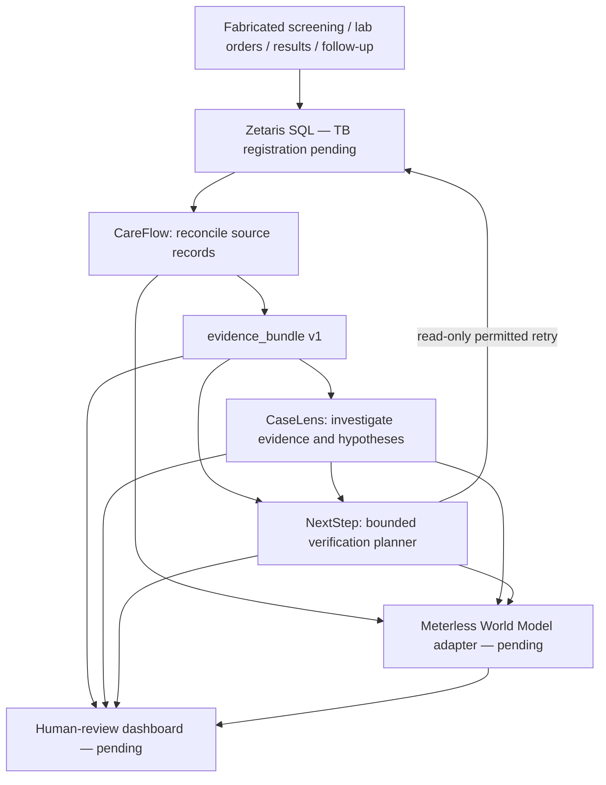

# TB-CareOS — planned cross-app architecture (21 Oct prebuild)

This is a **blueprint**, not a working three-app or sponsor-backed integration.

## Responsibilities and boundaries

**CareFlow:** resolve synthetic `case_id` evidence, preserve source IDs/timestamps, flag administrative mismatches/unavailable evidence. Emits `evidence_bundle.v1`.

**CaseLens:** accepts a saved `evidence_bundle.v1` independently, tests alternate nonclinical reasons for discrepancies and states what remains unknown. Emits `explanation_report.v1`. LLM reasoning requires separately verified inference integration.

**NextStep:** accepts the evidence bundle and optional explanation report, chooses a bounded permitted read-only lookup or human-review stop and preserves an audit-friendly rationale. Emits `verification_plan.v1`.

**Meterless World Model:** shared event-sourced case history/provenance (planned adapter, upstream reference verified independently). **Not** an inference provider.

**Human dashboard:** displays the bundle, explanation and allowed next verification while requiring coordinator approval.

### Future application endpoints — not running today
`POST /v1/reconcile`, `POST /v1/explain`, `POST /v1/plan` with JSON messages in `shared/contracts/`. Apps must also support input from saved fabricated fixtures for independent evaluation.

### Critical invariants

1. An unavailable source is not proof of an absent service or missed care.
2. All records are invented; no official SITB / SATUSEHAT / real patient access.
3. `ground_truth_holdout.csv` is reserved for **post-hoc evaluation**, never agent input.
4. Read-only bounded queries and human review; no autonomous outreach or clinical actions.
5. Preserve shared infrastructure but make candidate submissions technically distinct.
6. Multiple-entry eligibility and cross-track mapping **remain unverified**.

Original TB-CareFlow-only plan is retained at [architecture-careflow.md](architecture-careflow.md).
