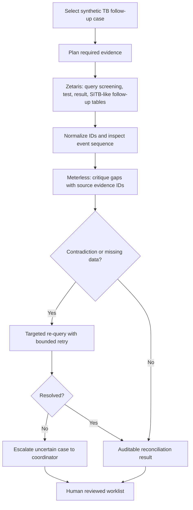

# TB-CareFlow — proposed investigation architecture

**This is intended architecture, NOT proof of sponsor integrations.** Existing Python pre-hackathon implementation is deterministic and generic; Zetaris and Meterless interfaces are unimplemented.

Target user: Puskesmas TB programme coordinator. Target task: exception investigation across synthetic screening, diagnostic and documented follow-up events.

Human clinician/coordinator must approve real-world follow-up, communications or changes to SITB. A missing event can mean data delay; it must not be equated with missing care or nonadherence.
