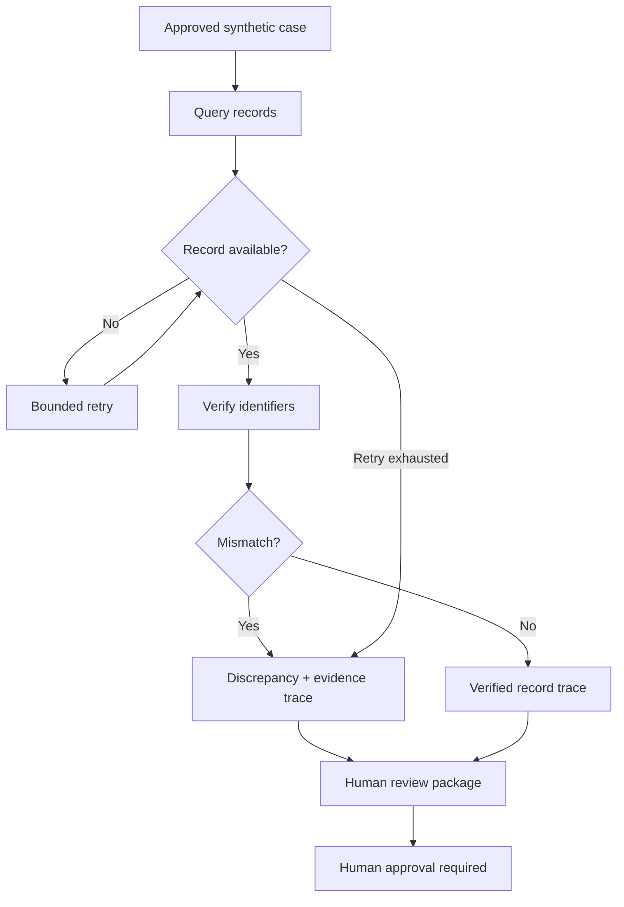

# Architecture v0 — problem neutral

The agent is **deterministic only at present**. Zetaris and Meterless are placeholders, not functioning integrations.
Unavailability is not proof of clinical or administrative wrongdoing. No autonomous patient routing, treatment, claims decisions or messaging.
